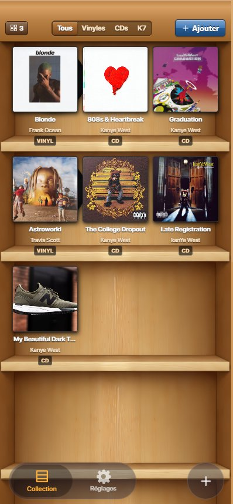
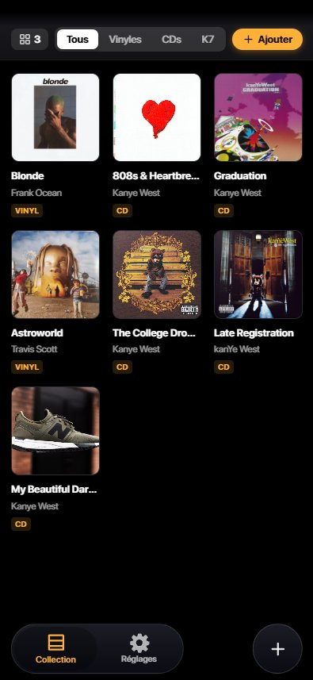

# 📀 ShelfApp

A mobile-first PWA to manage your physical music collection — vinyl, CDs, and cassettes — with a skeuomorphic iBooks-style shelf UI inspired by iOS aesthetics.

<p align="center">
  
  &nbsp;&nbsp;&nbsp;
  
</p>

---

## ✨ Features

- 📚 **Skeuomorphic shelf UI** — wood-textured shelves with composited artwork, iBooks-inspired
- 🎨 **Dark / Light themes** — adapts to system preferences
- 🔍 **Discogs integration** — search any album via the Discogs API, authenticated via OAuth
- ➕ **Add to collection** — save records with format (Vinyl / CD / K7), artwork, and metadata
- 🗂️ **Filter by format** — quickly toggle between All / Vinyl / CDs / K7
- 📷 **Barcode scanning** — scan physical media barcodes to identify releases (via `@zxing`)
- 🔐 **Auth** — user accounts powered by Supabase, collection synced to the cloud
- 📲 **PWA** — installable on iOS & Android, works offline with local IndexedDB storage
- 🧭 **Gesture navigation** — swipe-back gesture support, native-feeling routing

---

## 🛠️ Tech Stack

| Layer | Technology |
|---|---|
| Framework | React 19 + Vite |
| Language | TypeScript / JSX |
| Routing | React Router v7 |
| Animation | Framer Motion |
| Auth & DB | Supabase (PostgreSQL + Edge Functions) |
| Music data | Discogs API (OAuth 1.0a via Supabase Edge Function proxy) |
| Barcode scan | ZXing (`@zxing/browser`) |
| Local storage | IndexedDB (`idb`) |
| UI Icons | Lucide React |
| Testing | Vitest + Testing Library |
| Deployment | Vercel |

---

## 🏗️ Architecture

```
src/
├── components/
│   ├── auth/           # Login / account modals
│   ├── features/       # Discogs search, barcode scanner, add modal
│   ├── layout/         # Navbar, bottom tab bar
│   ├── onboarding/     # First-launch onboarding flow
│   ├── shelf/          # iBooks shelf rendering system
│   └── ui/             # Shared UI primitives
├── context/            # ShelfContext — global collection state
├── hooks/              # Custom hooks (gestures, Safari tint, audio…)
├── lib/                # Supabase client, Discogs OAuth, local cover storage
├── pages/              # Route-level page components
├── styles/             # Global CSS, wood shelf, animations
├── types/              # TypeScript types (Discogs, Database, app)
└── utils/              # Discogs data normalizer

supabase/
├── functions/
│   ├── discogs-auth/   # OAuth 1.0a token exchange
│   └── discogs-proxy/  # Authenticated API proxy
└── migrations/         # Database schema
```

---

## 🚀 Getting Started

### Prerequisites

- Node.js 18+
- A [Supabase](https://supabase.com) project
- A [Discogs](https://www.discogs.com/settings/developers) developer app (for OAuth)

### Installation

```bash
# Clone the repo
git clone https://github.com/your-username/ShelfApp.git
cd ShelfApp

# Install dependencies
npm install

# Set up environment variables
cp .env.example .env
# → Fill in your VITE_SUPABASE_URL and VITE_SUPABASE_ANON_KEY
```

### Environment Variables

```env
VITE_SUPABASE_URL=https://your-project-id.supabase.co
VITE_SUPABASE_ANON_KEY=your-anon-key-here
```

### Run locally

```bash
npm run dev
```

### Deploy Supabase Edge Functions

```bash
supabase functions deploy discogs-auth
supabase functions deploy discogs-proxy
```

---

## 🧪 Tests

```bash
npm test
```

Tests cover: Discogs OAuth flow, data normalization, proxy client, shelf context, and UI components.

---

## 📄 License

MIT
